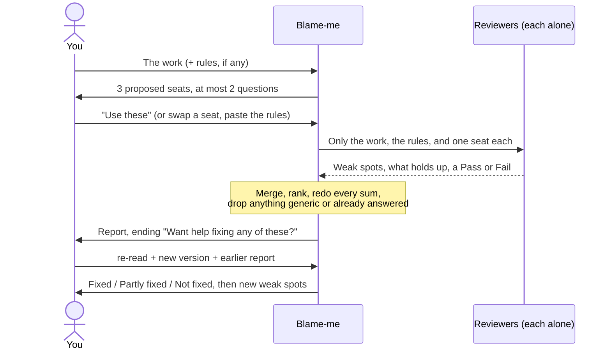

# Blame-me

**Let a pretend panel find what is wrong with your work, before the real one does.**

Tomorrow you present. Maybe it is a class project, an idea for a contest, or a proposal for your boss. You have read it three times and it looks fine, because you know what every part means. The people judging it tomorrow do not. They will read it for the first time, and one of them may put two of your numbers side by side and see that the plan cannot work.

Blame-me is for the night before. Give it your work, and the rules or the brief if there are any. It suggests a small panel of the people who will really judge it: a teacher, a contest judge, a customer, an accountant. You can change who sits on it. Then each of them reads your work as if for the first time, without your explanations, and looks for weak spots the way a tester looks for bugs.

You get back a list of weak spots, most serious first. Each one shows where it is in your work, when it will cause trouble, and a quick way to check it that you can do this week. You also get a short list of what already holds up, so you know what not to throw away, and the one thing to start with. It does not rewrite your work for you. At the end it asks which weak spots you want help with.

It is for anyone who has to present work: a student with no one to look at their project, or a professional getting ready for a client. The wording is plain on purpose.

**What has actually been tried** (by the author, on invented pieces of work, 2026-11-01; details in [Limits and untested parts](#limits-and-untested-parts)):

- A student contest entry (lunch boxes delivered to classroom buildings) and a business proposal (coffee for offices), both invented, each with weak spots planted in it. In every run the panel found the main planted ones: 100 boxes at 2 minutes each cannot be delivered in a one-hour lunch break; only 20 friends back the target of 100 a day; the proposal loses money on every office, which only shows when numbers from three sections are multiplied together. The author redid every sum in the reports; they were right.
- "Already holds up" picked out the parts that were fine on purpose, such as the students' own count of the lunchtime queue.
- With the contest's scoring rules, each reviewer scored against those rules, and the scores added up.
- Re-read: given a revised version and the earlier report, it marked each of the 12 old weak spots fixed, partly fixed, or not fixed, and found the mistake the fixes caused: fuel was added to the costs, but the profit per box was not changed.
- A casual "is this idea good?" first asks whether you want a quick opinion or the full panel, in your language. Asked on purpose (`/blame-me:blame-me`), it goes straight to the panel. Given code, it turns it away.
- It still makes mistakes, kept in the examples. Some findings state as fact what the work does not say. See [examples/README.md](examples/README.md).

**Not tried yet:** Claude.ai or other chat apps, resumes and articles, and real work by anyone other than the author.

To try it straight away, go to [Quick start](#quick-start): two install commands and one line.

### How it works

```mermaid
flowchart LR
    accTitle: How a review goes
    accDescr: The user gives the work. The skill proposes a panel and asks at most two questions. The user confirms or changes the panel. Each reviewer reads the work alone. The results are merged and checked. The user gets a report and can come back with a new version for a re-read.
    W["Your work<br/>+ rules, if any"] --> P["Panel proposed<br/>3 seats, at most 2 questions"]
    P -->|"you confirm<br/>or swap a seat"| R["Each reviewer<br/>reads alone"]
    R --> M["Merged and checked<br/>sums redone"]
    M --> Rep["Report<br/>weak spots, what holds up,<br/>where to start"]
    Rep -.->|"you fix it"| RR["Re-read<br/>fixed / partly / not fixed"]
```



A Claude Code skill. It is a set of plain-text instructions that Claude reads; it runs no code of its own and calls no service.

> **Not affiliated with Anthropic.** This is an independent, community-written skill. "Claude" and "Claude Code" are products of Anthropic; this project is not endorsed by or connected to Anthropic.

[ภาษาไทย](README.th.md)

## Contents

- [What it is for](#what-it-is-for)
- [Quick start](#quick-start)
- [What you type → what you get](#what-you-type--what-you-get)
- [One review, start to finish](#one-review-start-to-finish)
- [Reading the report](#reading-the-report)
- [Normal and harsh, side by side](#normal-and-harsh-side-by-side)
- [Tips for a better review](#tips-for-a-better-review)
- [What is in the package](#what-is-in-the-package)
- [What it does not do](#what-it-does-not-do)
- [Limits and untested parts](#limits-and-untested-parts)
- [FAQ](#faq)
- [Contributing](#contributing)
- [License](#license)

## What it is for

- Ideas, even a single paragraph
- School and university projects, reports, and presentations
- Contest entries and pitches
- Business plans and proposals to a client or a boss
- Case studies and take-home tasks for a job
- Resumes, cover letters, and scholarship or university applications
- Articles and posts

It is **not** for code or technical designs (use a code review), and it does not touch personal or life matters. A resume is read as a piece of work someone will judge, never as a judgement of you.

## Quick start

You need Claude Code. The runs on this page used version 2.1.316.

### 1. Install

```bash
claude plugin marketplace add SuruchBoss/Blame-me
claude plugin install blame-me@blame-me
```

Both commands are needed: `marketplace add` only adds the catalog, and `plugin install` installs the skill.

Without the marketplace, copy the folder `plugins/blame-me/skills/blame-me/` into `~/.claude/skills/` or into your project's `.claude/skills/`. The command is then `/blame-me` instead of `/blame-me:blame-me`.

Then open a new session. A skill installed during a session is not available in that same session.

### 2. Start a review

Point it at a file, or paste the work after the command:

```
/blame-me:blame-me path/to/your-work.md
```

| You type | What happens |
|---|---|
| `/blame-me:blame-me proposal.md` | Proposes a panel for the proposal and asks at most two questions |
| `/blame-me:blame-me harsh proposal.md` (or `โหมดแรง`, or "be harsh") | The same, and the report is written like a demanding boss |
| `/blame-me:blame-me re-read proposal-v2.md` and name the earlier report | Marks each earlier weak spot fixed, partly fixed, or not fixed, then reads the new version fresh |
| "blame this proposal", "find the holes in my project", "ด่าเลย" | Same as the command: straight to the panel |
| "is this idea good?", "any feedback?", "ไอเดียนี้ดีไหม", "ขอคอมเมนต์หน่อย" | Asks one question first: a quick opinion, or a full review by the panel? |
| A piece of code | Turned away; it suggests a code review instead |

### 3. Confirm the panel

The skill proposes three seats (at most five), each with who they are, what they look at first, and the one question that decides whether they say yes. It asks at most two things: who will read or judge the work, and whether there are rules or criteria. Then it waits.

Reply "use these", or swap a seat ("make the third one an accountant"), and paste the rules if you have them. If you already know who should sit on the panel, name them in your first message and it starts reading straight away.

### 4. Read the report, then ask for help

The report ends with one line: "Want help fixing any of these?" Answer with the numbers you want help on. See [Reading the report](#reading-the-report) for what each part means.

### 5. Re-read after you fix it

Give it the new version and the earlier report, with `re-read`. It reuses the same panel, checks each old weak spot against the new text, and then reads the new version as if for the first time, to catch problems the fixes caused.

## What you type → what you get

Every reply below is copied from a real run on 2026-11-01 (Claude Code 2.1.316, headless, clean home folder), using invented pieces of work. Long replies are shortened with "…". Thai replies have an English translation underneath. The full reports are in [`examples/`](examples/).

### 1. A casual ask → one question first

**You type:** ไอเดียนี้ดีไหม: จะเปิดร้านน้ำมะพร้าวปั่นหน้ามหาลัยช่วงปิดเทอม แก้วละ 35 บาท ต้นทุนแก้วละ 20 คิดว่าขายได้วันละ 100 แก้วเพราะคนเดินผ่านเยอะ เช่าที่เดือนละ 6,000 ทำคนเดี่ยว
*("Is this idea good? A coconut smoothie stall in front of the university during the break, 35 baht a cup, cost 20, I think 100 cups a day because lots of people walk by, rent 6,000 a month, working alone")*

**You get:**

> อยากได้ความเห็นสั้นๆ หรือให้กรรมการจำลองอ่านแบบจริงจัง
> *("Do you want a quick opinion, or a serious read by a pretend panel?")*

Nothing else. It waits for your answer.

### 2. "Short is fine" → a normal reply, no panel

**You type:** สั้นๆ พอ *("short is fine")*

**You get** (shortened, translated):

> **In short: the numbers per cup are fine, but assuming 100 cups a day is the most doubtful part.**
>
> 15 baht profit a cup means 400 cups a month, about 13 a day, just to cover the rent…
>
> 1. **Lots of people walk by, but it is the break.** Most people in front of a university are students, and many go home in the break…
> 2. **Walking by is not buying.** If 1,000 people pass and 5% buy, that is 50 cups…
> 3. **The 20-baht cost may be missing things:** ice, electricity, the blender, a permit, coconuts that go bad…
> 4. **100 cups alone:** over 6 hours, one cup every 3 to 4 minutes…
>
> **Checks you can do in 3 to 4 days:** stand at the spot at selling time and count people per hour; sell for 1 to 2 days and count cups…
>
> If you want the pretend panel to read it seriously, just say so.

No seats, no levels, no report layout.

### 3. Asked on purpose → straight to the panel

**You type:**

```
/blame-me:blame-me I want to start a weekend dog-walking service in my apartment building. 150 baht per 30-minute walk, I can do 8 walks a day, and there are about 40 dogs in the building.
```

**You get:**

> **Proposed panel (3 readers)**
>
> 1. **Building management (the juristic person or condo office).** They decide if this is allowed at all. They look first at rules on pets in common areas, lifts, and running a business from the building. Deciding question: "If a dog bites someone or damages something, who is responsible, and do the building rules allow this?"
> 2. **A dog owner in the building.** They pay, and they hand over their dog. … Deciding question: "Would I give my keys and my dog to this person for 150 baht, and what do I get if the dog is hurt or lost?"
> 3. **A neighbor without a dog.** This is the seat that is easy to forget. They share the lifts, lobby, and gardens. … Deciding question: "Does this make my daily life in the building worse, and would I complain to management?"
>
> Two questions before the panel reads:
>
> 1. Who will actually read or judge this? For example, a landlord, building management, a class, or only you. If it is only you, the panel above stays as is.
> 2. Is there a brief, a rubric, or building rules the panel should check against? If so, paste them.
>
> Please confirm the panel or swap a seat. For example, replace the neighbor with a vet or an accountant. A harsh mode also exists if you want the same findings in blunter words.

### 4. Panel confirmed, with scoring rules → the report

**You type:** the lunch-box contest entry ([`examples/student-idea.th.md`](examples/student-idea.th.md)), the contest's scoring rules ([`examples/student-criteria.th.md`](examples/student-criteria.th.md)), and the panel it proposed: a contest judge, a classmate who would buy, and someone who already sells lunch boxes.

**You get** (opening of [`examples/student-report-normal.th.md`](examples/student-report-normal.th.md), translated):

> **Verdicts**
>
> | Reviewer | Verdict | Feasible (40) | Problem and customers (30) | Presentation (30) | Total |
> |---|---|---|---|---|---|
> | Contest judge | **Fail** | 14 | 18 | 17 | 49 |
> | Classmate who would buy | **Fail** | 16 | 18 | 18 | 52 |
> | Lunch-box seller | **Fail** | 12 | 15 | 18 | 45 |
>
> **1. 100 boxes cannot be delivered in one hour** (3/3) **Must fix first**
> - **Where in the work:** "about 2 minutes per box", 12:00–13:00, against "100 boxes a day"
> - **When:** from the first day orders go over 30–60 boxes
> - **Problem:** 100 × 2 = 200 minutes, but there are 60. One person delivers about 30 boxes, two about 60. The last boxes arrive around 13:00, when lunch may be over. The work does not say whether 2 minutes includes parking and walking up to the building.
> - **Quick way to check:** really deliver 10–15 boxes to several buildings, time the whole round, and work out how many boxes fit in one hour.
>
> **2. The evidence is 20 customers, the target is 100 boxes** (3/3) **Must fix first** …
>
> … 12 weak spots in all …
>
> **Already holds up**
> - **Cost and profit per box:** redone and right: 28 + 4 + 3 = 35, and 45 − 35 = 10…
> - **The queue problem:** has a day, a time, and a count the students made themselves (38 and 41 people at 12:05), not just a claim; but only one day was counted.
>
> **Start here:** item 1. Really deliver 10–15 boxes and time the round; the result says whether 100 boxes is possible at all, and what target item 2 should use.
>
> Want help fixing any of these?

### 5. Re-read after fixes → what changed, and what the fixes broke

**You type:**

```
/blame-me:blame-me re-read idea-v2.th.md  (earlier report: report.th.md, rules: criteria.th.md, same panel)
```

The new version ([`examples/student-idea-v2.th.md`](examples/student-idea-v2.th.md)) lowers the target to 40 boxes, closes orders earlier, adds a real delivery trial and three days of paid pre-orders, and adds fuel to the costs, but forgets to change the profit per box.

**You get** (shortened, translated; full report in [`examples/student-reread.th.md`](examples/student-reread.th.md)):

> **Earlier weak spots**
>
> 1. **100 boxes cannot be delivered in one hour: Fixed.** The target is now "start at 40 boxes a day", with a real trial: "15 boxes to 3 buildings in 25 minutes in all", which works out to 36 boxes per person per hour…
> 2. **20 customers of evidence, a target of 100: Partly fixed.** Paid pre-orders now: "14, 17 and 12 people really paid", and the target is 40, but the average paid is still under half of it…
> 5. **The monthly target counts days with no sales: Fixed.** "About 22 school days a month", but the profit per box is now wrong (see new item 1).
> 8. **Nothing says 45 baht is better value than the canteen: Not fixed.** …
>
> **New weak spots**
>
> **1. [Must fix first · 3/3] The profit per box does not match the costs the work itself lists**
> - Where in the work: "cost per box" (28 + 4 + 3 + 2) against "10 baht profit per box", and the "Target" section
> - When it goes wrong: when a judge picks up a calculator
> - Problem: 28 + 4 + 3 + 2 = 37, not 35. At 45 baht that leaves 8 baht profit, not 10. 40 × 8 = 320 a day, not 400; 320 × 22 = 7,040 a month, not 8,800, which is 1,760 baht short. This comes from adding fuel without changing the numbers that depend on it.
> - Quick way to check: add up the new costs, then take the receipts from one real day of cooking and divide by the number of boxes.
>
> **2. [Must fix first · 3/3] A target of 40 boxes is far above what people really paid for**
> - … 43 boxes over the 3 days, 14.3 on average, 17 at most. 40 is 2.8 times the average. At 14.3 boxes × 8 baht × 22 days, that is about 2,500 baht a month, not 8,800…
>
> … 6 new weak spots in all …
>
> **Start here:** new item 1 (the profit per box is 8, not 10). Redo the costs against one day's receipts, and only then use the right number to set the target in item 2, because the judges stop believing the other numbers as soon as they find the first wrong one.

### 6. Code → turned away

**You type:**

```
/blame-me:blame-me
def avg(xs):
    total = 0
    for x in xs:
        total += x
    return total / len(xs)
```

**You get:**

> This skill does not review code. The panel reads ideas, projects, pitches, proposals, resumes and articles. It can't give a useful read on a Python function.
>
> For this function, a code review is the right tool. Run `/code-review`, or paste the function into a normal chat and ask for a review.

Asked casually instead ("ฟังก์ชันนี้ดีไหม ขอคอมเมนต์หน่อย", "is this function good? any comments?"), the skill was not loaded at all, and Claude answered with an ordinary code review.

## One review, start to finish



What each step does:

1. **It checks what you gave it.** Code and personal matters are turned away.
2. **It proposes a panel.** Three people by default, at most five. It always includes the person who decides, the person who pays or has to live with the result, and one seat people tend to forget. It asks at most two questions and does not ask you to fill in missing facts; finding those is the panel's job.
3. **Each person reads on their own.** They see only your work, the rules, and their own seat. Not your explanations, and not each other's views. In Claude Code they run as separate helpers. Where that is not possible, one model plays each seat in turn, and the report says so.
4. **The results are put together and checked.** The same weak spot raised by several people moves up the list. Every sum is redone. Anything without a place in your work, anything that could be said about any work, and anything your work already answers is dropped. Things that cannot be checked from your work go under "Needs checking" instead of being stated as facts.
5. **You get the report.**
6. **Re-read**, if you come back with a new version.

## Reading the report

The report always has the same parts, in this order:

| Part | What it tells you |
|---|---|
| Opening line | Who sat on the panel, whether they read separately or one model played each seat, and what they saw |
| Verdicts | Pass or Fail from each seat, with a reason. Scores only if you gave scoring rules, using your rules |
| Weak spots | Most serious first, with how many reviewers raised it (for example 3/3) |
| Already holds up | Up to three things the panel tried to break and could not, and what was checked |
| Needs checking | What could not be checked from the work, and what to check |
| Start here | The one weak spot to deal with first, and its quick check |
| Last line | "Want help fixing any of these?" |

Weak spots have three levels:

| Level | Meaning |
|---|---|
| **Must fix first** | If it is true, the whole work fails. Every sale loses money; the brief asks for X and X is not there. |
| **Should fix** | The reader will say no, or stop believing the work, unless it is fixed. |
| **Good to fix** | It makes the work weaker or look careless, but does not sink it. |

Each weak spot has four parts:

- **Where in the work:** the place, or a short quote. No place in the work, no weak spot.
- **When it goes wrong:** the real moment it causes trouble: the judge asks X, the first customer does Y, week three arrives.
- **Quick way to check:** the smallest, cheapest thing you can do within about a week to find out if it is true. Ask five people, sell for one day, redo the sum. Not "hire a research firm".
- No fixes. The panel says what is wrong, not how to rewrite it. Ask for help at the end if you want it.

An English report ([`examples/brewbox-report-in-turn.en.md`](examples/brewbox-report-in-turn.en.md), item 1, shortened; the Thai quotes are translated):

```
1. Each office costs more than it pays (Must fix first, raised by 3/3)
   Where: "Cost per office per month" table, and "gross profit about 60%".
   When it goes wrong: 20 people × 2 cups × 15 g × 22 days = 13.2 kg of beans, 7,920 baht.
     With shipping and equipment wear, 8,390 baht. The price is 4,900 baht,
     so every office loses about 3,490 baht a month.
   Quick way to check: Redo the bean sum in a spreadsheet using only numbers
     from the proposal. It takes ten minutes.
```

## Normal and harsh, side by side

**Normal** is calm and plain. **Harsh** sounds like a demanding boss in a meeting: blunt about the work, never about you, never rude. Both are meant to find the same weak spots; only the wording changes.

The same weak spot in an invented school idea, a tutoring app where students pay 20 baht a session and the only support is "my friends said it's a good idea":

> **Normal:** The whole income section depends on 1,200 students using it every week. The only support is that friends liked the idea. Liking an idea is not the same as paying 20 baht for it every week.

> **Harsh:** Every number in the income section stands on "my friends said it's a good idea". That will not survive the first question from a judge. Friends being nice does not mean people will buy.

Harsh mode is used only when you ask for it: `harsh`, `โหมดแรง`, "be harsh", "ด่าเลย". More examples in both languages: [references/tone.md](plugins/blame-me/skills/blame-me/references/tone.md).

## Tips for a better review

- **Give it the rules.** A rubric, contest rules, or a client's brief turns vague opinions into scores against what you will really be judged on.
- **Put the real reader on the panel.** If your boss's boss decides, or an accountant will check the numbers, swap a seat for them.
- **Give it the whole work.** The panel only judges what is on the page. An appendix it cannot see is an appendix that does not exist.
- **Do the quick checks before you rewrite.** Some weak spots will turn out not to be real. The checks tell you which.
- **Re-read after big changes.** Fixes often break something else: a number changed in one place but not another.

## What is in the package

```
plugins/blame-me/skills/blame-me/
  SKILL.md              everything needed to run a review
  references/
    panel.md            who to put on the panel, for student and professional work
    angles.md           places to look, and what does not count as a weak spot
    report.md           report layout, English and Thai, and plain-word swaps
    tone.md             normal and harsh, with examples
    reread.md           re-read after fixes
examples/               invented pieces of work and the reports made from them
```

`SKILL.md` holds every rule on its own, so a review still works if the tool cannot open the other files.

## What it does not do

- It does not rewrite your work. It says what is wrong; it helps fix only the items you choose.
- It does not know your market, your teacher, or your client. It reads only what is on the page.
- It does not review code, settings files, or technical designs.
- It does not judge you, or give advice on personal or life matters.
- It does not make up facts, prices, competitors, or rules. What it cannot check goes under "Needs checking".
- It does not run code or call any service. It is plain-text instructions that Claude reads.

## Limits and untested parts

All runs below: Claude Code 2.1.316, headless (`claude -p`), Linux, 2026-11-01, plugin loaded with `--plugin-dir` (except the install test), default model, in a clean home folder. Costs are what the CLI reported for that run.

| Part | Status |
|---|---|
| Suggesting a panel and waiting | Tried with the student idea, the business proposal, a Thai stall idea, and an English dog-walking idea. Each time it proposed fitting seats and waited (about $0.06 to $0.15). |
| Asking at most two questions | Before the limit was written, one Thai run asked six. After it, four runs (Thai and English) asked one or two. |
| Reviewers as separate helpers | Tried in six runs: three helpers started together each time (about $0.5 to $0.8 a run). |
| One model playing each seat in turn | Tried once with the helper tool switched off, report in English. The report said which way was used (about $0.1). |
| Scoring against rules | Tried twice with a contest's scoring rules: scores used the rules' parts and added up. |
| Normal and harsh finding the same things | Mostly. In the two student runs the main weak spots matched; a few were ranked differently. |
| Re-read after fixes | Tried once: the student idea, revised with one mistake planted that a fix causes (fuel added to the costs, profit per box not changed), the earlier report, the scoring rules, and the same panel. Three separate helpers. Every earlier weak spot got a status with a quote from the new version, and the planted mistake came out as new item 1, Must fix first, 3/3 (about $0.67). All three reviewers gave exactly the same scores, which the report itself pointed out as odd. |
| Casual asks ("is this idea good?") | Tried with one Thai and one English idea. A casual ask loaded the skill on its own each time, and it asked the one question in the user's language and waited (8 runs). Answering "short" gave a plain reply with no panel. Answering "full review" went to the panel. The first English run wrote "tell me" and "I'll run it"; after a rule was added, the re-runs did not. Other languages untested. |
| Turning away code | Asked on purpose with a Python function: turned away, with a code review suggested (1 run). Asked casually about the same function in Thai: the skill was not loaded, and Claude gave an ordinary code review (1 run). |
| Turning away personal matters | Untested |
| Plain words | In the first round, a few harder words got through ("helper", "ค่าเสื่อม" for depreciation, "moot"). After a rule to look for them was added, the reports run again had none. |
| Gender-neutral wording in Thai | Before the rule was added, one early run wrote "ผม" (a male "I"). After it, no Thai reply did. |
| Notes while waiting, in the work's language | Some notes in early Thai runs were in English. A rule was added afterwards; not checked since. |
| Accuracy | Every sum the author checked was right. Some findings still go further than the work says, even after a rule against it was added (see [examples/README.md](examples/README.md)). Read the findings before acting on them. |
| Installing from GitHub | Tried once on 2026-11-01 in an empty home folder: `claude plugin marketplace add SuruchBoss/Blame-me` then `claude plugin install blame-me@blame-me` worked. |
| Resumes, applications, articles | Untested |
| Claude.ai or other chat apps | Untested |
| Your own instruction files | If a CLAUDE.md or similar sets a voice or pronouns, the report may follow it. Seen once during development; the example runs used a clean home folder. |
| Real work by other people | Untested |

A pretend panel is not a real one. It does not know your market, your teacher, or the person who will read your resume. It can only read what is on the page, carefully and without taking your side. Treat "Needs checking" as homework, not as findings.

## FAQ

**Is it free?**
Yes. The skill is free and licensed under Apache 2.0. You still need your own access to Claude Code, and a review uses your usage like any other request: in the runs above, a panel proposal cost about $0.06 to $0.15 and a full review with separate helpers about $0.5 to $0.8.

**Which languages?**
It answers in the language of your work. The skill and its report layouts are written for English and Thai, and those are the only languages tested.

**Can I pick my own panel?**
Yes. Swap any seat when it proposes one, or name the panel in your first message and it starts reading straight away. At most five seats.

**Will it be nice to me?**
No, but it will not be rude either. It does not soften findings or pad them with praise. Harsh mode is blunter, still about the work and never about you. It also tells you what already holds up, so you do not throw away the good parts.

**Does it rewrite my work?**
No. It ends by asking which weak spots you want help with. Rewriting is your call.

**Does it send my work anywhere?**
The skill itself is plain text and contains no code, so it sends nothing anywhere. Your work is read by Claude Code, which handles it the same way it does without this skill.

**Why did it ask me a question instead of reviewing?**
Either you asked casually ("is this idea good?"), and it wants to know whether you want a quick opinion or the full panel, or it is proposing the panel and waiting for you to confirm it. Name the panel in your first message, or use `/blame-me:blame-me`, to skip the first question.

## Contributing

Found a problem, or a step these docs do not explain? [Open an issue](https://github.com/SuruchBoss/Blame-me/issues/new). Please leave out tokens, session IDs, and anything private, and do not paste work you are not allowed to share.

## License

Apache License 2.0. See [LICENSE](LICENSE) and [NOTICE](NOTICE).
