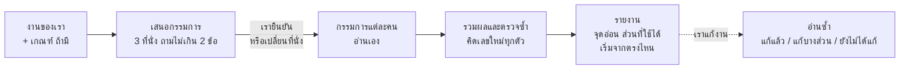
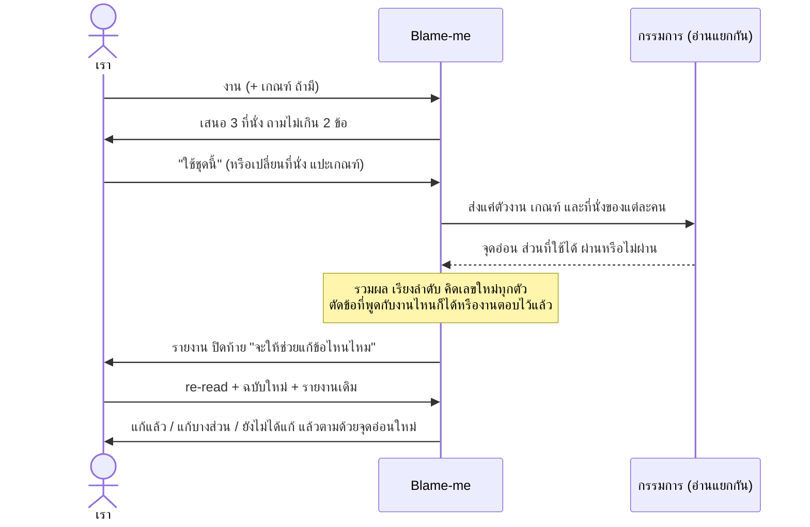

# Blame-me

**ให้กรรมการจำลองหาจุดอ่อนในงานของเราก่อน ก่อนที่กรรมการตัวจริงจะเจอ**

พรุ่งนี้ต้องนำเสนอแล้ว อาจเป็นโครงงานส่งอาจารย์ ไอเดียส่งประกวด หรือข้อเสนอให้หัวหน้า เราอ่านทวนมาสามรอบ ดูแล้วก็ไม่มีอะไรผิด เพราะเรารู้อยู่แล้วว่าแต่ละส่วนหมายถึงอะไร แต่คนที่จะตัดสินพรุ่งนี้ไม่รู้ เขาจะอ่านเป็นครั้งแรก และอาจมีสักคนที่เอาตัวเลขสองตัวในงานเรามาวางเทียบกัน แล้วเห็นว่าแผนนี้เป็นไปไม่ได้

Blame-me มีไว้สำหรับคืนก่อนวันนั้น ส่งงานให้มัน พร้อมโจทย์หรือเกณฑ์ถ้ามี มันจะเสนอกรรมการชุดเล็กๆ ที่เป็นคนที่จะตัดสินงานนี้จริง เช่น อาจารย์ กรรมการประกวด ลูกค้า หรือนักบัญชี เราเปลี่ยนตัวกรรมการเองได้ แล้วกรรมการแต่ละคนจะอ่านงานเหมือนเพิ่งเห็นครั้งแรก โดยไม่มีคำอธิบายจากเรา และไล่หาจุดอ่อนแบบที่คนทดสอบโปรแกรมไล่หาบั๊ก

สิ่งที่ได้กลับมาคือรายการจุดอ่อน เรียงจากหนักไปเบา แต่ละข้อบอกว่าอยู่ตรงไหนในงาน จะเป็นปัญหาตอนไหน และมีวิธีเช็กง่ายๆ ที่ทำได้ภายในสัปดาห์นี้ นอกจากนั้นยังบอกส่วนที่ใช้ได้แล้ว จะได้รู้ว่าอะไรไม่ต้องทิ้ง และบอกข้อเดียวที่ควรเริ่มก่อน มันไม่เขียนงานใหม่ให้ ท้ายรายงานจะถามว่าอยากให้ช่วยแก้ข้อไหน

ใช้ได้กับทุกคนที่ต้องนำเสนองาน ตั้งแต่นักเรียนนักศึกษาที่ไม่มีใครช่วยดูงาน ไปจนถึงคนทำงานที่ต้องเตรียมตัวก่อนเจอลูกค้า ภาษาที่ใช้ตั้งใจให้ง่าย

**สิ่งที่ลองจริงแล้ว** (ผู้เขียนลองกับงานสมมติ วันที่ 2026-11-01 รายละเอียดอยู่ที่ [ข้อจำกัดและส่วนที่ยังไม่ได้ทดสอบ](#ข้อจำกัดและส่วนที่ยังไม่ได้ทดสอบ))

- ไอเดียประกวดของนักศึกษา (ส่งข้าวกล่องถึงตึกเรียน) กับข้อเสนอธุรกิจ (กาแฟส่งออฟฟิศ) ทั้งสองชิ้นเป็นงานสมมติที่ฝังจุดอ่อนไว้ ทุกรอบกรรมการเจอจุดหลักที่ฝังไว้ เช่น 100 กล่อง กล่องละ 2 นาที ส่งไม่ทันในพักเที่ยงชั่วโมงเดียว, มีเพื่อนยืนยันแค่ 20 คนแต่ตั้งเป้าวันละ 100 กล่อง, ข้อเสนอธุรกิจขาดทุนทุกออฟฟิศ ซึ่งจะเห็นก็ต่อเมื่อเอาตัวเลขจากสามหัวข้อมาคูณกัน ผู้เขียนคิดเลขในรายงานซ้ำทุกตัว ถูกหมด
- "ส่วนที่ใช้ได้แล้ว" เลือกส่วนที่ตั้งใจให้ถูกออกมาได้ เช่น การที่นักศึกษาไปนับคิวโรงอาหารเอง
- เมื่อให้เกณฑ์ประกวดไป กรรมการให้คะแนนตามเกณฑ์นั้น และคะแนนบวกกันได้ตรง
- อ่านซ้ำ: ให้ฉบับแก้กับรายงานเดิมไป มันบอกสถานะข้อเดิมครบทั้ง 12 ข้อว่าแก้แล้ว แก้บางส่วน หรือยังไม่ได้แก้ และจับจุดที่การแก้ทำพังได้ คือเพิ่มค่าน้ำมันในต้นทุนแต่ไม่ได้แก้กำไรต่อกล่อง
- ถามแบบสบายๆ ว่า "ไอเดียนี้ดีไหม" มันจะถามกลับก่อนในภาษาของเราว่าอยากได้ความเห็นสั้นๆ หรือให้กรรมการอ่าน ถ้าเรียกแบบตั้งใจ (`/blame-me:blame-me`) จะไปเสนอกรรมการเลย ถ้าส่งโค้ดไป มันจะปฏิเสธ
- ยังพลาดอยู่บ้าง และเก็บไว้ในตัวอย่างตามจริง บางข้อพูดเหมือนเป็นความจริงทั้งที่งานไม่ได้บอก ดู [examples/README.md](examples/README.md)

**ยังไม่ได้ลอง:** ใช้ใน Claude.ai หรือแอปแชทอื่น เรซูเม่และบทความ และงานจริงของคนอื่นนอกจากผู้เขียน

อยากลองเลยไปที่ [เริ่มใช้](#เริ่มใช้) ติดตั้งสองคำสั่ง แล้วพิมพ์อีกบรรทัดเดียว

### ทำงานยังไง



เป็นสกิลของ Claude Code เป็นคำสั่งข้อความธรรมดาที่ Claude อ่าน ไม่มีโค้ดของตัวเองให้รัน และไม่เรียกบริการภายนอก

> **ไม่ได้เกี่ยวข้องกับ Anthropic** สกิลนี้เขียนขึ้นเองโดยอิสระ "Claude" และ "Claude Code" เป็นผลิตภัณฑ์ของ Anthropic โปรเจกต์นี้ไม่ได้รับการรับรองและไม่ได้เกี่ยวข้องกับ Anthropic

[English](README.md)

## สารบัญ

- [ใช้กับงานอะไรได้บ้าง](#ใช้กับงานอะไรได้บ้าง)
- [เริ่มใช้](#เริ่มใช้)
- [พิมพ์อะไร ได้อะไร](#พิมพ์อะไร-ได้อะไร)
- [รีวิวหนึ่งรอบ ตั้งแต่ต้นจนจบ](#รีวิวหนึ่งรอบ-ตั้งแต่ต้นจนจบ)
- [อ่านรายงานยังไง](#อ่านรายงานยังไง)
- [ปกติกับแรง เทียบกัน](#ปกติกับแรง-เทียบกัน)
- [ทำยังไงให้รีวิวออกมาดี](#ทำยังไงให้รีวิวออกมาดี)
- [ในแพ็กเกจมีอะไร](#ในแพ็กเกจมีอะไร)
- [สิ่งที่มันไม่ทำ](#สิ่งที่มันไม่ทำ)
- [ข้อจำกัดและส่วนที่ยังไม่ได้ทดสอบ](#ข้อจำกัดและส่วนที่ยังไม่ได้ทดสอบ)
- [คำถามที่พบบ่อย](#คำถามที่พบบ่อย)
- [แจ้งปัญหา](#แจ้งปัญหา)
- [License](#license)

## ใช้กับงานอะไรได้บ้าง

- ไอเดีย แม้จะมีแค่ย่อหน้าเดียว
- โครงงาน รายงาน และการนำเสนอในโรงเรียนหรือมหาวิทยาลัย
- งานประกวดและการ pitch
- แผนธุรกิจ และข้อเสนอให้ลูกค้าหรือหัวหน้า
- case study และงานที่บริษัทให้ทำตอนสมัครงาน
- เรซูเม่ จดหมายสมัครงาน ใบสมัครทุนหรือสมัครเรียนต่อ
- บทความและโพสต์

**ไม่ใช้** กับโค้ดหรือการออกแบบทางเทคนิค (ให้ใช้ code review แทน) และไม่แตะเรื่องส่วนตัวหรือเรื่องชีวิต เรซูเม่จะถูกอ่านในฐานะงานชิ้นหนึ่งที่มีคนจะตัดสิน ไม่ใช่การตัดสินตัวเรา

## เริ่มใช้

ต้องมี Claude Code ตัวอย่างในหน้านี้รันด้วยเวอร์ชัน 2.1.316

### 1. ติดตั้ง

```bash
claude plugin marketplace add SuruchBoss/Blame-me
claude plugin install blame-me@blame-me
```

ต้องรันทั้งสองคำสั่ง `marketplace add` แค่เพิ่มรายการ ส่วน `plugin install` คือการติดตั้งสกิลจริง

ถ้าไม่ใช้ marketplace ให้คัดลอกโฟลเดอร์ `plugins/blame-me/skills/blame-me/` ไปไว้ที่ `~/.claude/skills/` หรือ `.claude/skills/` ของโปรเจกต์ แล้วคำสั่งจะเป็น `/blame-me` แทน `/blame-me:blame-me`

จากนั้นเปิด session ใหม่ สกิลที่ติดตั้งระหว่าง session ยังใช้ใน session เดิมไม่ได้

### 2. เริ่มรีวิว

ชี้ไปที่ไฟล์ หรือแปะเนื้องานต่อท้ายคำสั่งก็ได้

```
/blame-me:blame-me path/to/your-work.md
```

| พิมพ์ว่า | จะเกิดอะไร |
|---|---|
| `/blame-me:blame-me proposal.md` | เสนอกรรมการสำหรับงานนี้ แล้วถามไม่เกินสองข้อ |
| `/blame-me:blame-me โหมดแรง proposal.md` (หรือ `harsh` หรือ "ด่าแรงๆ เลย") | เหมือนกัน แต่รายงานพูดแบบหัวหน้าที่เข้มงวด |
| `/blame-me:blame-me re-read proposal-v2.md` แล้วบอกว่ารายงานเดิมคือไฟล์ไหน | บอกว่าข้อเดิมแก้แล้ว แก้บางส่วน หรือยังไม่ได้แก้ แล้วอ่านฉบับใหม่เหมือนเพิ่งเห็น |
| "blame ข้อเสนอนี้หน่อย" "หาจุดอ่อนในโครงงานนี้ให้หน่อย" "ด่าเลย" | เหมือนใช้คำสั่ง ไปเสนอกรรมการเลย |
| "ไอเดียนี้ดีไหม" "ขอคอมเมนต์หน่อย" "ขาดอะไรไปไหม" "any feedback?" | ถามกลับหนึ่งข้อก่อน ว่าอยากได้ความเห็นสั้นๆ หรือให้กรรมการอ่านแบบจริงจัง |
| โค้ด | ปฏิเสธ และแนะนำให้ใช้ code review แทน |

### 3. ยืนยันกรรมการ

สกิลจะเสนอกรรมการสามที่นั่ง (มากสุดห้า) แต่ละที่นั่งบอกว่าเป็นใคร ดูอะไรก่อน และคำถามข้อเดียวที่ตัดสินว่าเขาจะตอบรับไหม แล้วถามเราไม่เกินสองข้อ คือใครจะอ่านหรือตัดสินงานนี้ และมีเกณฑ์หรือโจทย์ไหม จากนั้นจะหยุดรอ

ตอบว่า "ใช้ชุดนี้" หรือเปลี่ยนที่นั่ง ("ที่นั่งที่สามขอเป็นนักบัญชี") แล้วแปะเกณฑ์ถ้ามี ถ้ารู้อยู่แล้วว่าอยากได้กรรมการแบบไหน บอกไปตั้งแต่ข้อความแรกได้เลย มันจะเริ่มอ่านทันที

### 4. อ่านรายงาน แล้วขอให้ช่วย

บรรทัดสุดท้ายของรายงานคือ "จะให้ช่วยแก้ข้อไหนไหม" ตอบด้วยเลขข้อที่อยากให้ช่วย ความหมายของแต่ละส่วนดูได้ที่ [อ่านรายงานยังไง](#อ่านรายงานยังไง)

### 5. อ่านซ้ำหลังแก้

ส่งฉบับใหม่กับรายงานเดิมไป พร้อมคำว่า `re-read` มันจะใช้กรรมการชุดเดิม ไล่ข้อเดิมเทียบกับฉบับใหม่ทีละข้อ แล้วอ่านฉบับใหม่เหมือนเพิ่งเห็นครั้งแรก เพื่อหาปัญหาที่การแก้ทำให้เกิดขึ้นใหม่

## พิมพ์อะไร ได้อะไร

ทุกคำตอบด้านล่างคัดมาจากการรันจริงวันที่ 2026-11-01 (Claude Code 2.1.316 แบบ headless ในโฟลเดอร์ home ที่สะอาด) กับงานสมมติ คำตอบยาวตัดด้วย "…" คำตอบภาษาอังกฤษมีคำแปลไทยกำกับ รายงานฉบับเต็มอยู่ใน [`examples/`](examples/)

### 1. ถามแบบสบายๆ → ถามกลับหนึ่งข้อก่อน

**พิมพ์ว่า:** ไอเดียนี้ดีไหม: จะเปิดร้านน้ำมะพร้าวปั่นหน้ามหาลัยช่วงปิดเทอม แก้วละ 35 บาท ต้นทุนแก้วละ 20 คิดว่าขายได้วันละ 100 แก้วเพราะคนเดินผ่านเยอะ เช่าที่เดือนละ 6,000 ทำคนเดี่ยว

**ได้กลับมา:**

> อยากได้ความเห็นสั้นๆ หรือให้กรรมการจำลองอ่านแบบจริงจัง

แค่นั้น แล้วหยุดรอคำตอบ

### 2. "สั้นๆ พอ" → ตอบแบบปกติ ไม่มีกรรมการ

**พิมพ์ว่า:** สั้นๆ พอ

**ได้กลับมา** (ตัดให้สั้น)

> **สรุปสั้นๆ: ตัวเลขต่อแก้วดี แต่ข้อสมมติว่าขายได้วันละ 100 แก้วน่าสงสัยที่สุด**
>
> กำไรแก้วละ 15 บาท (35 − 20) ค่าเช่า 6,000 บาทต้องขายเดือนละ 400 แก้ว หรือราว 13 แก้วต่อวัน จึงจะคุ้มค่าเช่า ซึ่งต่ำมาก…
>
> 1. **คนเดินผ่านเยอะ แต่เป็นช่วงปิดเทอม** คนที่เดินผ่านหน้ามหาลัยส่วนใหญ่คือนักศึกษา ช่วงปิดเทอมคนหายไปมาก…
> 2. **คนเดินผ่านเยอะไม่เท่ากับคนซื้อเยอะ** ถ้าคนเดินผ่าน 1,000 คนแล้วซื้อ 5% จะได้แค่ 50 แก้ว
> 3. **ต้นทุน 20 บาทอาจไม่ครบ** ยังไม่เห็นค่าน้ำแข็ง ค่าไฟ ค่าเครื่องปั่น ตู้เย็นหรือถังแช่ ค่าขออนุญาตตั้งร้าน และมะพร้าวที่เสียหรือเหลือทิ้ง…
> 4. **ทำคนเดียว 100 แก้ว** ถ้าขายวันละ 6 ชั่วโมง เฉลี่ยทุก 3-4 นาทีต้องปั่นหนึ่งแก้ว…
>
> **เช็กได้ภายใน 3-4 วัน**
> - ไปยืนที่จุดนั้นในช่วงเวลาขายจริง นับคนเดินผ่านต่อชั่วโมง
> - ลองขายจริงสัก 1-2 วัน แล้วดูว่าขายได้กี่แก้ว…
>
> ถ้าอยากให้กรรมการจำลองอ่านแบบจริงจัง บอกได้เลย

ไม่มีที่นั่งกรรมการ ไม่มีป้ายระดับ ไม่มีรูปแบบรายงาน

### 3. เรียกแบบตั้งใจ → เสนอกรรมการเลย

**พิมพ์ว่า:**

```
/blame-me:blame-me I want to start a weekend dog-walking service in my apartment building. 150 baht per 30-minute walk, I can do 8 walks a day, and there are about 40 dogs in the building.
```

*(อยากเปิดบริการพาหมาเดินเล่นวันหยุดในคอนโดตัวเอง ครั้งละ 150 บาท 30 นาที วันละ 8 รอบ ในตึกมีหมาราว 40 ตัว)*

**ได้กลับมา:**

> **Proposed panel (3 readers)**
>
> 1. **Building management (the juristic person or condo office).** They decide if this is allowed at all. … Deciding question: "If a dog bites someone or damages something, who is responsible, and do the building rules allow this?"
> 2. **A dog owner in the building.** They pay, and they hand over their dog. … Deciding question: "Would I give my keys and my dog to this person for 150 baht, and what do I get if the dog is hurt or lost?"
> 3. **A neighbor without a dog.** This is the seat that is easy to forget. … Deciding question: "Does this make my daily life in the building worse, and would I complain to management?"
>
> Two questions before the panel reads:
>
> 1. Who will actually read or judge this? …
> 2. Is there a brief, a rubric, or building rules the panel should check against? …
>
> Please confirm the panel or swap a seat. …

*(คำแปล: เสนอกรรมการสามคน คือนิติบุคคลอาคาร ผู้ตัดสินว่าทำได้ไหม, เจ้าของหมาในตึก คนจ่ายเงินและฝากหมา, และเพื่อนบ้านที่ไม่ได้เลี้ยงหมา ที่นั่งที่คนมักลืม เพราะใช้ลิฟต์และพื้นที่ส่วนกลางร่วมกัน แล้วถามสองข้อ คือใครจะอ่านหรือตัดสินงานนี้ และมีกฎหรือเกณฑ์ให้เทียบไหม จากนั้นให้ยืนยันหรือเปลี่ยนที่นั่ง)*

### 4. ยืนยันกรรมการพร้อมเกณฑ์ → ได้รายงาน

**ส่งไป:** ไอเดียข้าวกล่อง ([`examples/student-idea.th.md`](examples/student-idea.th.md)) เกณฑ์ประกวด ([`examples/student-criteria.th.md`](examples/student-criteria.th.md)) และกรรมการที่มันเสนอ คือกรรมการตัดสินประกวด เพื่อนนักศึกษาที่จะเป็นลูกค้า และเจ้าของร้านข้าวกล่อง

**ได้กลับมา** (ต้นรายงาน [`examples/student-report-normal.th.md`](examples/student-report-normal.th.md))

> **คำตัดสิน**
>
> | กรรมการ | คำตัดสิน | ทำได้จริง (40) | ปัญหาและลูกค้า (30) | นำเสนอ (30) | รวม |
> |---|---|---|---|---|---|
> | กรรมการประกวด | **ไม่ผ่าน** | 14 | 18 | 17 | 49 |
> | เพื่อนที่เป็นลูกค้า | **ไม่ผ่าน** | 16 | 18 | 18 | 52 |
> | เจ้าของร้านข้าวกล่อง | **ไม่ผ่าน** | 12 | 15 | 18 | 45 |
>
> **1. ส่ง 100 กล่องไม่ทันใน 1 ชั่วโมง** (3/3) **ต้องแก้ก่อนไปต่อ**
> - **ที่ในงาน:** "ส่งกล่องละประมาณ 2 นาที" ช่วง 12:00–13:00 เทียบกับ "ขายวันละ 100 กล่อง"
> - **เมื่อไหร่:** ตั้งแต่วันแรกที่ออเดอร์เกิน 30–60 กล่อง
> - **ปัญหา:** 100 × 2 = 200 นาที แต่ช่วงส่งมีแค่ 60 นาที คนเดียวส่งได้ราว 30 กล่อง สองคนราว 60 กล่อง กล่องท้ายๆ จะถึงมือราว 13:00 ซึ่งอาจหมดพักแล้ว งานยังไม่ได้บอกว่า 2 นาทีรวมจอดรถและเดินขึ้นตึกไหม
> - **วิธีเช็ก:** ส่งจริง 10–15 กล่องไปหลายตึก จับเวลาทั้งรอบ แล้วหาว่าชั่วโมงเดียวส่งได้กี่กล่อง
>
> **2. หลักฐานลูกค้ามี 20 คน แต่เป้าคือ 100 กล่อง** (3/3) **ต้องแก้ก่อนไปต่อ** …
>
> … รวม 12 ข้อ …
>
> **ผ่านการลองทำลายแล้วยังอยู่**
> - **ต้นทุนและกำไรต่อกล่อง:** คิดใหม่แล้วตรง 28 + 4 + 3 = 35 และ 45 − 35 = 10 …
> - **ปัญหาคิวยาว:** มีวัน เวลา และจำนวนคนที่นับเอง (38 และ 41 คน เวลา 12:05) ไม่ใช่การพูดลอยๆ แต่ยังนับแค่วันเดียว
>
> **เริ่มที่นี่:** เริ่มที่ข้อ 1 (ส่ง 100 กล่องไม่ทัน): ส่งจริง 10–15 กล่องไปหลายตึกแล้วจับเวลาทั้งรอบ เพราะผลที่ได้จะบอกว่า 100 กล่องเป็นไปได้ไหม และกำหนดว่าข้อ 2 ควรตั้งเป้ากี่กล่อง
>
> จะให้ช่วยแก้ข้อไหนไหม

### 5. อ่านซ้ำหลังแก้ → อะไรเปลี่ยน และการแก้ทำอะไรพัง

**พิมพ์ว่า:**

```
/blame-me:blame-me re-read idea-v2.th.md รายงานเดิมอยู่ใน report.th.md เกณฑ์ประกวดอยู่ใน criteria.th.md ใช้กรรมการชุดเดิม
```

ฉบับใหม่ ([`examples/student-idea-v2.th.md`](examples/student-idea-v2.th.md)) ลดเป้าเหลือ 40 กล่อง ปิดรับออเดอร์เร็วขึ้น ลองส่งจริง เปิดจองแบบโอนเงินก่อนสามวัน และเพิ่มค่าน้ำมันในต้นทุน แต่ลืมแก้กำไรต่อกล่อง

**ได้กลับมา** (ตัดให้สั้น ฉบับเต็มอยู่ที่ [`examples/student-reread.th.md`](examples/student-reread.th.md))

> **ข้อเดิม**
>
> 1. **ส่ง 100 กล่องไม่ทันใน 1 ชั่วโมง: แก้แล้ว** เป้าลดเหลือ "เริ่มที่วันละ 40 กล่อง" และมีการลองจริง "ส่ง 15 กล่องไป 3 ตึก ใช้เวลารวม 25 นาที" ซึ่งคิดได้ 36 กล่องต่อคนต่อชั่วโมง …
> 2. **หลักฐานลูกค้า 20 คน แต่เป้า 100 กล่อง: แก้บางส่วน** เปิดจองโอนเงินก่อนแล้ว "มีคนโอนจริง 14, 17 และ 12 คน" และเป้าลดเหลือ 40 แต่ยอดจ่ายจริงเฉลี่ยยังไม่ถึงครึ่งของเป้า …
> 5. **เป้ากำไรรายเดือนคิดจากวันที่ไม่ได้ขาย: แก้แล้ว** "เปิดขายวันเรียนเดือนละประมาณ 22 วัน" แต่ตัวเลขกำไรต่อกล่องผิด (ดูข้อใหม่ 1)
> 8. **ไม่บอกว่า 45 บาทคุ้มกว่าโรงอาหารไหม: ยังไม่ได้แก้** …
>
> **จุดอ่อนใหม่**
>
> **1. [ต้องแก้ก่อนไปต่อ · 3/3] กำไรต่อกล่องไม่ตรงกับต้นทุนที่เขียนเอง**
> - ตรงไหนในงาน: "ต้นทุนต่อกล่อง" (28 + 4 + 3 + 2) เทียบกับ "กำไรกล่องละ 10 บาท" และหัวข้อ "เป้าหมาย"
> - จะเป็นปัญหาตอนไหน: ตอนกรรมการกดเครื่องคิดเลข
> - ปัญหา: 28 + 4 + 3 + 2 = 37 ไม่ใช่ 35 ขาย 45 บาทเหลือกำไร 8 บาท ไม่ใช่ 10 วันละ 40 × 8 = 320 ไม่ใช่ 400 เดือนละ 320 × 22 = 7,040 ไม่ใช่ 8,800 ขาดไป 1,760 บาท ข้อนี้เกิดจากการเพิ่มค่าน้ำมันแล้วไม่ได้แก้ตัวเลขที่ตามมา
> - ลองเช็กง่ายๆ: บวกต้นทุนใหม่ แล้วจดต้นทุนจริงจากใบเสร็จของหนึ่งวันที่ทำจริง หารด้วยจำนวนกล่อง
>
> **2. [ต้องแก้ก่อนไปต่อ · 3/3] เป้า 40 กล่องสูงกว่ายอดที่คนจ่ายเงินจริงมาก**
> - … ยอดจอง 3 วันรวม 43 กล่อง เฉลี่ย 14.3 กล่อง สูงสุด 17 เป้า 40 เป็น 2.8 เท่าของค่าเฉลี่ย ที่ 14.3 กล่อง × 8 บาท × 22 วัน ได้เดือนละราว 2,500 บาท ไม่ใช่ 8,800 …
>
> … รวม 6 ข้อใหม่ …
>
> **เริ่มที่นี่:** เริ่มที่ข้อใหม่ 1 (กำไรต่อกล่องเป็น 8 ไม่ใช่ 10): บวกต้นทุนใหม่และเทียบกับใบเสร็จจริงของหนึ่งวัน แล้วค่อยใช้ตัวเลขที่ถูกไปกำหนดเป้าในข้อ 2 เพราะกรรมการจะเริ่มไม่เชื่อตัวเลขอื่นทันทีที่เจอตัวเลขแรกที่ผิด

### 6. โค้ด → ปฏิเสธ

**พิมพ์ว่า:**

```
/blame-me:blame-me
def avg(xs):
    total = 0
    for x in xs:
        total += x
    return total / len(xs)
```

**ได้กลับมา:**

> This skill does not review code. The panel reads ideas, projects, pitches, proposals, resumes and articles. It can't give a useful read on a Python function.
>
> For this function, a code review is the right tool. Run `/code-review`, or paste the function into a normal chat and ask for a review.

*(คำแปล: สกิลนี้ไม่รีวิวโค้ด กรรมการอ่านไอเดีย โครงงาน pitch ข้อเสนอ เรซูเม่ และบทความ สำหรับฟังก์ชันนี้ให้ใช้ code review แทน)*

ถ้าถามแบบสบายๆ แทน ("ฟังก์ชันนี้ดีไหม ขอคอมเมนต์หน่อย") สกิลจะไม่ถูกเรียกขึ้นมาเลย Claude ตอบเป็นการรีวิวโค้ดธรรมดา

## รีวิวหนึ่งรอบ ตั้งแต่ต้นจนจบ



แต่ละขั้นทำอะไร

1. **ดูก่อนว่าส่งอะไรมา** โค้ดและเรื่องส่วนตัวจะถูกปฏิเสธ
2. **เสนอกรรมการ** ค่าเริ่มต้นสามคน มากสุดห้าคน มีคนที่ตัดสินใจ คนที่ต้องจ่ายหรือต้องอยู่กับผลลัพธ์ และอีกที่นั่งที่เรามักลืมเสมอ ถามเราไม่เกินสองข้อ และไม่ขอให้เราเติมข้อมูลที่งานขาด เพราะการหาจุดนั้นเป็นหน้าที่ของกรรมการ
3. **แต่ละคนอ่านเอง** เห็นแค่ตัวงาน เกณฑ์ และบทบาทของตัวเอง ไม่เห็นคำอธิบายของเรา ไม่เห็นความเห็นของกันและกัน ใน Claude Code แต่ละคนเป็นผู้ช่วยแยกกัน ถ้าทำแบบนั้นไม่ได้ จะมีโมเดลเดียวสลับเล่นทีละบทบาท และรายงานจะบอกไว้
4. **รวมผลแล้วตรวจซ้ำ** จุดอ่อนที่หลายคนพูดตรงกันจะขึ้นไปอยู่สูง ทุกตัวเลขถูกคิดใหม่ ข้อที่ไม่ได้ชี้ไปที่ตรงไหนในงาน ข้อที่พูดกับงานไหนก็ได้ และข้อที่งานตอบไว้แล้ว จะถูกตัดทิ้ง ส่วนเรื่องที่เช็กจากตัวงานไม่ได้จะไปอยู่ใน "ต้องเช็กเพิ่ม" แทนที่จะถูกพูดเหมือนเป็นความจริง
5. **ได้รายงาน**
6. **อ่านซ้ำ** ถ้าเรากลับมาพร้อมฉบับแก้

## อ่านรายงานยังไง

รายงานมีส่วนเดิมทุกครั้ง เรียงตามนี้

| ส่วน | บอกอะไร |
|---|---|
| บรรทัดเปิด | กรรมการเป็นใคร อ่านแยกกันหรือโมเดลเดียวสลับบทบาท และได้เห็นอะไรบ้าง |
| คำตัดสิน | ผ่านหรือไม่ผ่านจากแต่ละที่นั่ง พร้อมเหตุผล ให้คะแนนเฉพาะเมื่อเรามีเกณฑ์ และใช้เกณฑ์ของเรา |
| จุดอ่อน | เรียงจากหนักไปเบา พร้อมจำนวนกรรมการที่พูดถึง (เช่น 3/3) |
| ส่วนที่ใช้ได้แล้ว | ไม่เกินสามข้อที่กรรมการพยายามหาจุดพังแล้วไม่เจอ และบอกว่าเช็กอะไรไป |
| ต้องเช็กเพิ่ม | สิ่งที่เช็กจากตัวงานไม่ได้ และควรไปเช็กอะไร |
| เริ่มที่นี่ | จุดอ่อนข้อเดียวที่ควรจัดการก่อน พร้อมวิธีเช็ก |
| บรรทัดสุดท้าย | "จะให้ช่วยแก้ข้อไหนไหม" |

จุดอ่อนมีสามระดับ

| ระดับ | ความหมาย |
|---|---|
| **ต้องแก้ก่อนไปต่อ** | ถ้าจริง งานล้มทั้งชิ้น เช่น ขายทุกชิ้นขาดทุน หรือโจทย์ขอ X แต่ไม่มี X |
| **ควรแก้** | คนอ่านจะตอบไม่ หรือเลิกเชื่องาน ถ้าไม่แก้ |
| **แก้ก็ดี** | ทำให้งานอ่อนลงหรือดูไม่รอบคอบ แต่ไม่ถึงกับล้ม |

จุดอ่อนแต่ละข้อมีสี่ส่วน

- **ตรงไหนในงาน:** จุดที่อยู่ หรือข้อความสั้นๆ ที่ยกมา ไม่มีที่ในงาน ไม่นับเป็นจุดอ่อน
- **จะเป็นปัญหาตอนไหน:** ช่วงเวลาจริงที่มันจะก่อเรื่อง เช่น กรรมการถาม X ลูกค้าคนแรกทำ Y หรือพอถึงสัปดาห์ที่สาม
- **ลองเช็กง่ายๆ:** สิ่งที่เล็กที่สุดและถูกที่สุดที่เราทำได้ภายในราวหนึ่งสัปดาห์ เพื่อรู้ว่าจริงไหม เช่น ถามคนห้าคน ลองขายหนึ่งวัน คิดเลขใหม่ ไม่ใช่ "จ้างบริษัทวิจัย"
- ไม่มีวิธีแก้ กรรมการบอกว่าอะไรผิด ไม่ได้บอกว่าต้องเขียนใหม่ยังไง ถ้าอยากได้ความช่วยเหลือให้ขอตอนท้าย

จุดอ่อนหนึ่งข้อหน้าตาแบบนี้ (ข้อ 1 ของ [examples/student-report-normal.th.md](examples/student-report-normal.th.md) ไม่ได้แก้)

```
1. ส่ง 100 กล่องไม่ทันใน 1 ชั่วโมง (3/3) ต้องแก้ก่อนไปต่อ
- ที่ในงาน: "ส่งกล่องละประมาณ 2 นาที" ช่วง 12:00–13:00 เทียบกับ "ขายวันละ 100 กล่อง"
- เมื่อไหร่: ตั้งแต่วันแรกที่ออเดอร์เกิน 30–60 กล่อง
- ปัญหา: 100 × 2 = 200 นาที แต่ช่วงส่งมีแค่ 60 นาที คนเดียวส่งได้ราว 30 กล่อง สองคนราว 60 กล่อง
- วิธีเช็ก: ส่งจริง 10–15 กล่องไปหลายตึก จับเวลาทั้งรอบ แล้วหาว่าชั่วโมงเดียวส่งได้กี่กล่อง
```

## ปกติกับแรง เทียบกัน

**ปกติ** พูดนิ่งๆ ตรงๆ **แรง** พูดเหมือนหัวหน้าที่เข้มงวดในห้องประชุม ตรงเรื่องงาน แต่ไม่พูดถึงตัวเรา และไม่หยาบ ทั้งสองโหมดตั้งใจให้เจอจุดอ่อนเดียวกัน ต่างกันแค่คำพูด

จุดอ่อนข้อเดียวกันของไอเดียสมมติ แอปจับคู่ติวหนังสือในโรงเรียน ครั้งละ 20 บาท ที่มีหลักฐานแค่ "เพื่อนบอกว่าไอเดียดี"

> **ปกติ:** รายได้ทั้งหัวข้อขึ้นอยู่กับนักเรียน 1,200 คนที่ใช้ทุกสัปดาห์ หลักฐานมีแค่ว่าเพื่อนชอบไอเดีย การชอบไอเดียไม่เหมือนกับยอมจ่าย 20 บาททุกสัปดาห์

> **แรง:** ตัวเลขทุกตัวในหัวข้อรายได้ตั้งอยู่บน "เพื่อนบอกว่าไอเดียดี" ประโยคนี้ไม่รอดคำถามแรกของกรรมการ เพื่อนพูดดีด้วยไม่ได้แปลว่าจะมีคนซื้อ

โหมดแรงใช้เฉพาะตอนเราขอ: `โหมดแรง` `harsh` "ด่าแรงๆ เลย" "ด่าเลย" ตัวอย่างเพิ่มเติมทั้งสองภาษาอยู่ที่ [references/tone.md](plugins/blame-me/skills/blame-me/references/tone.md)

## ทำยังไงให้รีวิวออกมาดี

- **ให้เกณฑ์ไปด้วย** เกณฑ์ของอาจารย์ กติกาประกวด หรือโจทย์จากลูกค้า จะเปลี่ยนความเห็นกว้างๆ ให้เป็นคะแนนตามสิ่งที่เราจะถูกตัดสินจริง
- **ใส่คนอ่านตัวจริงลงในกรรมการ** ถ้าหัวหน้าของหัวหน้าเป็นคนตัดสิน หรือมีนักบัญชีตรวจตัวเลข ให้เปลี่ยนที่นั่งเป็นคนนั้น
- **ส่งงานไปให้ครบ** กรรมการตัดสินแค่สิ่งที่อยู่บนหน้ากระดาษ ภาคผนวกที่มันมองไม่เห็นก็เท่ากับไม่มี
- **ลองเช็กก่อนเขียนใหม่** จุดอ่อนบางข้ออาจไม่จริง วิธีเช็กจะบอกว่าข้อไหน
- **อ่านซ้ำหลังแก้ครั้งใหญ่** การแก้มักทำอย่างอื่นพัง เช่น แก้ตัวเลขที่เดียวแต่ไม่แก้อีกที่

## ในแพ็กเกจมีอะไร

```
plugins/blame-me/skills/blame-me/
  SKILL.md              ทุกอย่างที่ต้องใช้ในการรีวิวหนึ่งรอบ
  references/
    panel.md            เลือกกรรมการ สำหรับงานนักเรียนและงานคนทำงาน
    angles.md           จุดที่ควรดู และอะไรที่ไม่นับเป็นจุดอ่อน
    report.md           รูปแบบรายงาน ไทยและอังกฤษ และคำง่ายที่ใช้แทนศัพท์ยาก
    tone.md             โหมดปกติและโหมดแรง พร้อมตัวอย่าง
    reread.md           อ่านซ้ำหลังแก้
examples/               งานสมมติ และรายงานที่ได้จากการรันจริง
```

`SKILL.md` มีกฎครบในตัว ถ้าเครื่องมือเปิดไฟล์อื่นไม่ได้ ก็ยังรีวิวได้

## สิ่งที่มันไม่ทำ

- ไม่เขียนงานใหม่ให้ บอกว่าอะไรผิด และช่วยแก้เฉพาะข้อที่เราเลือก
- ไม่รู้จักตลาด อาจารย์ หรือลูกค้าของเรา อ่านได้แค่สิ่งที่อยู่บนหน้ากระดาษ
- ไม่รีวิวโค้ด ไฟล์ตั้งค่า หรือการออกแบบทางเทคนิค
- ไม่ตัดสินตัวเรา และไม่ให้คำแนะนำเรื่องส่วนตัวหรือเรื่องชีวิต
- ไม่แต่งข้อเท็จจริง ราคา คู่แข่ง หรือกฎขึ้นมาเอง สิ่งที่เช็กไม่ได้จะอยู่ใน "ต้องเช็กเพิ่ม"
- ไม่รันโค้ดและไม่เรียกบริการภายนอก เป็นแค่คำสั่งข้อความธรรมดาที่ Claude อ่าน

## ข้อจำกัดและส่วนที่ยังไม่ได้ทดสอบ

ทุกรอบด้านล่าง: Claude Code 2.1.316 รันแบบ headless (`claude -p`) บน Linux วันที่ 2026-11-01 โหลด plugin ด้วย `--plugin-dir` (ยกเว้นรอบทดสอบติดตั้ง) ใช้โมเดลค่าเริ่มต้น ในโฟลเดอร์ home ที่สะอาด ค่าใช้จ่ายเป็นตัวเลขที่ CLI รายงานของรอบนั้น

| ส่วน | สถานะ |
|---|---|
| เสนอกรรมการแล้วหยุดรอ | ลองกับไอเดียนักศึกษา ข้อเสนอธุรกิจ ไอเดียร้านน้ำปั่นภาษาไทย และไอเดียพาหมาเดินภาษาอังกฤษ ทุกครั้งเสนอที่นั่งที่เข้ากับงานแล้วหยุดรอ (ราว $0.06 ถึง $0.15) |
| ถามกลับไม่เกินสองข้อ | ก่อนเขียนกฎนี้ มีรอบไทยหนึ่งรอบที่ถามถึงหกข้อ หลังเขียนกฎ สี่รอบ (ไทยและอังกฤษ) ถามหนึ่งหรือสองข้อ |
| กรรมการแยกเป็นผู้ช่วย | ลองหกรอบ เปิดผู้ช่วยสามตัวพร้อมกันทุกครั้ง (ราว $0.5 ถึง $0.8 ต่อรอบ) |
| โมเดลเดียวสลับเล่นทีละบทบาท | ลองหนึ่งครั้ง โดยปิดเครื่องมือผู้ช่วย และให้รายงานเป็นภาษาอังกฤษ รายงานบอกว่าใช้วิธีไหน (ราว $0.1) |
| ให้คะแนนตามเกณฑ์ | ลองสองครั้งกับเกณฑ์ประกวด คะแนนแยกตามหัวข้อของเกณฑ์ และบวกกันได้ตรง |
| โหมดปกติกับโหมดแรงเจอเรื่องเดียวกัน | ส่วนใหญ่ใช่ ในงานนักศึกษาสองรอบ จุดอ่อนหลักตรงกัน แต่บางข้อจัดระดับต่างกัน |
| อ่านซ้ำหลังแก้ | ลองหนึ่งครั้ง: ไอเดียนักศึกษาฉบับแก้ที่ฝังจุดพังจากการแก้ไว้หนึ่งจุด (เพิ่มค่าน้ำมันแต่ไม่แก้กำไรต่อกล่อง) พร้อมรายงานเดิม เกณฑ์ และกรรมการชุดเดิม ใช้ผู้ช่วยแยกสามตัว ข้อเดิมทุกข้อได้สถานะพร้อมข้อความจากฉบับใหม่ และจุดที่ฝังไว้ขึ้นมาเป็นข้อใหม่ข้อ 1 ระดับต้องแก้ก่อนไปต่อ 3/3 (ราว $0.67) กรรมการทั้งสามให้คะแนนเท่ากันทุกช่อง ซึ่งรายงานก็ทักเองว่าแปลก |
| ถามแบบสบายๆ ("ไอเดียนี้ดีไหม") | ลองกับไอเดียภาษาไทยหนึ่งชิ้นและอังกฤษหนึ่งชิ้น ถามสบายๆ แล้วสกิลถูกเรียกเองทุกครั้ง ถามคำถามเดียวในภาษาของผู้ใช้แล้วหยุดรอ (8 รอบ) ตอบว่า "สั้นๆ" ได้คำตอบธรรมดา ไม่มีกรรมการ ตอบว่า "จริงจัง" ไปเสนอกรรมการ รอบอังกฤษแรกเขียน "tell me" กับ "I'll run it" หลังเพิ่มกฎ รอบที่รันใหม่ไม่มีแล้ว ภาษาอื่นยังไม่ได้ลอง |
| ปฏิเสธโค้ด | เรียกตั้งใจพร้อมฟังก์ชัน Python: ปฏิเสธและแนะนำ code review (1 รอบ) ถามสบายๆ เป็นไทยเรื่องฟังก์ชันเดียวกัน: สกิลไม่ถูกเรียก Claude ตอบเป็นการรีวิวโค้ดธรรมดา (1 รอบ) |
| ปฏิเสธเรื่องส่วนตัว | ยังไม่ได้ลอง |
| คำง่าย | รอบแรกมีคำยากหลุดมาบ้าง ("helper" "ค่าเสื่อม" "moot") หลังเพิ่มกฎให้ไล่หาคำยาก รายงานที่รันใหม่ไม่มีเลย |
| ภาษาไทยที่ไม่ระบุเพศ | ก่อนเพิ่มกฎ มีรอบแรกๆ หนึ่งรอบที่ใช้ "ผม" หลังเพิ่มกฎ ไม่มีคำตอบภาษาไทยไหนใช้อีก |
| ข้อความระหว่างรอ ใช้ภาษาเดียวกับงาน | บางข้อความในรอบภาษาไทยแรกๆ ออกมาเป็นภาษาอังกฤษ เพิ่มกฎทีหลังแล้ว ยังไม่ได้เช็กอีก |
| ความแม่นยำ | ตัวเลขทุกตัวที่ผู้เขียนตรวจถูกหมด แต่ยังมีบางข้อที่พูดเกินกว่าที่งานบอก แม้จะเพิ่มกฎห้ามแล้ว (ดู [examples/README.md](examples/README.md)) อ่านข้อติก่อนเชื่อ |
| ติดตั้งจาก GitHub | ลองหนึ่งครั้ง วันที่ 2026-11-01 ในโฟลเดอร์ home เปล่า `claude plugin marketplace add SuruchBoss/Blame-me` แล้ว `claude plugin install blame-me@blame-me` ติดตั้งได้ |
| เรซูเม่ ใบสมัคร บทความ | ยังไม่ได้ลอง |
| Claude.ai หรือแอปแชทอื่น | ยังไม่ได้ลอง |
| ไฟล์คำสั่งส่วนตัวของเรา | ถ้า CLAUDE.md หรือไฟล์คล้ายกันกำหนดน้ำเสียงหรือสรรพนาม รายงานอาจทำตามนั้น เห็นหนึ่งครั้งตอนพัฒนา รอบในตัวอย่างใช้โฟลเดอร์ home ที่สะอาด |
| งานจริงของคนอื่น | ยังไม่ได้ลอง |

กรรมการจำลองไม่ใช่กรรมการจริง มันไม่รู้จักตลาดของเรา อาจารย์ของเรา หรือคนที่จะอ่านเรซูเม่ของเรา มันอ่านได้แค่สิ่งที่อยู่บนหน้ากระดาษ แต่อ่านอย่างละเอียดและไม่เข้าข้างเรา เรื่องใน "ต้องเช็กเพิ่ม" ให้ถือเป็นการบ้าน ไม่ใช่ข้อสรุป

## คำถามที่พบบ่อย

**ฟรีไหม**
ฟรี สกิลนี้ใช้ไลเซนส์ Apache 2.0 แต่ต้องมีสิทธิ์ใช้ Claude Code ของตัวเอง และการรีวิวจะใช้โควตาเหมือนคำขออื่นๆ ในรอบทดสอบด้านบน การเสนอกรรมการใช้ราว $0.06 ถึง $0.15 ส่วนรีวิวเต็มแบบผู้ช่วยแยกใช้ราว $0.5 ถึง $0.8

**ใช้ภาษาอะไรได้บ้าง**
ตอบตามภาษาของงาน ตัวสกิลกับรูปแบบรายงานเขียนไว้สำหรับไทยและอังกฤษ และสองภาษานี้เท่านั้นที่ลองแล้ว

**เลือกกรรมการเองได้ไหม**
ได้ เปลี่ยนที่นั่งไหนก็ได้ตอนที่มันเสนอ หรือบอกกรรมการไปตั้งแต่ข้อความแรก มันจะเริ่มอ่านทันที มากสุดห้าที่นั่ง

**จะพูดดีๆ กับเราไหม**
ไม่โอ๋ แต่ก็ไม่หยาบ ไม่ทำให้ข้อติเบาลง และไม่ชมแก้เขิน โหมดแรงจะตรงกว่า แต่ยังพูดเรื่องงาน ไม่พูดถึงตัวเรา และมันบอกส่วนที่ใช้ได้แล้วด้วย จะได้ไม่ทิ้งส่วนที่ดี

**มันเขียนงานใหม่ให้ไหม**
ไม่ ท้ายรายงานจะถามว่าอยากให้ช่วยแก้ข้อไหน การเขียนใหม่เป็นเรื่องที่เราตัดสินเอง

**ส่งงานของเราไปที่ไหนไหม**
ตัวสกิลเป็นข้อความธรรมดา ไม่มีโค้ด จึงไม่ส่งอะไรไปไหน งานของเราถูกอ่านโดย Claude Code ซึ่งจัดการข้อมูลแบบเดียวกับตอนที่ไม่มีสกิลนี้

**ทำไมมันถามกลับแทนที่จะรีวิวเลย**
มีสองแบบ แบบแรกเราถามแบบสบายๆ ("ไอเดียนี้ดีไหม") มันเลยอยากรู้ว่าอยากได้ความเห็นสั้นๆ หรือให้กรรมการอ่าน แบบที่สองมันกำลังเสนอกรรมการและรอให้เรายืนยัน ถ้าอยากข้ามคำถามแรก ให้ใช้ `/blame-me:blame-me` หรือบอกกรรมการไปตั้งแต่ข้อความแรก

## แจ้งปัญหา

เจอปัญหา หรือมีขั้นตอนไหนที่เอกสารนี้ไม่ได้อธิบาย [เปิด issue](https://github.com/SuruchBoss/Blame-me/issues/new) ได้เลย อย่าใส่ token, session ID หรือข้อมูลส่วนตัว และอย่าแปะงานที่เราไม่มีสิทธิ์เผยแพร่

## License

Apache License 2.0 ดู [LICENSE](LICENSE) และ [NOTICE](NOTICE)
